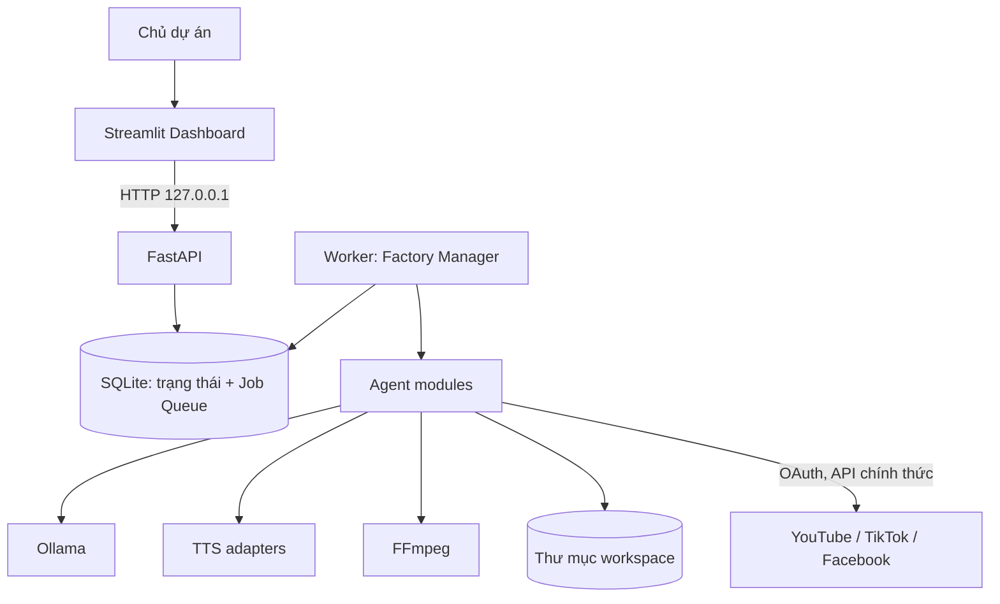
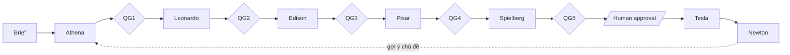

# AI VIDEO FACTORY – ARCHITECTURE

> Trạng thái: thiết kế, **chưa có code**. Cấu trúc Factory Manager + 7 Agent và bộ công nghệ ở `TECH_STACK.md` mục 2 đã được Chủ dự án duyệt. Các chi tiết đánh dấu **[Đề xuất]** là phần mở rộng của Lead Developer, **chưa được duyệt**, chờ theo `DECISIONS.md`.
>
> Bản sửa 1 (2026-10-30): xử lý [REVIEW_REPORT.md](REVIEW_REPORT.md) của Codex. Phản hồi tại [REVIEW_RESPONSE.md](REVIEW_RESPONSE.md).

## 1. Tổng quan

**[Đề xuất – D-009]** Hệ thống là một monolith module hóa chạy trên một máy, gồm ba tiến trình. MVP dùng đúng **một Worker** và một tác vụ nặng tại một thời điểm; nhiều worker chỉ được xem xét khi có số đo cho thấy cần:

| Tiến trình | Công nghệ | Trách nhiệm |
|---|---|---|
| Dashboard | Streamlit | Giao diện cho Chủ dự án; chỉ gọi FastAPI |
| API | FastAPI | Cổng duy nhất vào hệ thống; tạo run, trả trạng thái, nhận phê duyệt |
| Worker | Python | Chạy Factory Manager, lấy job từ hàng đợi và thực thi tuần tự từng Agent |

Dịch vụ phụ thuộc: Ollama (LLM cục bộ, chỉ nghe localhost), FFmpeg (gọi như tiến trình con), SQLite (tệp cục bộ).



Thiết kế API-first để sau này website hoặc ứng dụng thay thế Streamlit mà không đổi lõi.

## 2. Pipeline sản xuất



| Agent | Đầu vào | Đầu ra chính | Dùng LLM |
|---|---|---|---|
| Athena | Brief, nguồn do người dùng cung cấp | `research_brief.json` | Có |
| Leonardo | `research_brief.json` | `script.json`, `storyboard.json` | Có |
| Edison | Lời thoại, bảng nhân vật | Âm thanh từng câu, `voice_manifest.json`, timing | Không |
| Pixar | Storyboard, timing, âm thanh | Scene spec SVG, dữ liệu viseme | Không |
| Spielberg | Scene spec, âm thanh | Clip từng cảnh, phụ đề, MP4, thumbnail, metadata | Tùy (metadata) |
| Tesla | Bản đã phê duyệt | Bản ghi xuất bản | Không |
| Newton | Dữ liệu từ API nền tảng | Báo cáo hiệu suất | Tùy |

Đặc tả từng Agent: [docs/agents/README.md](docs/agents/README.md).

## 3. Factory Manager

Là một module điều phối, không phải Agent và không chứa logic nghiệp vụ. Trách nhiệm:

- Giữ máy trạng thái của mỗi run; chỉ một thành phần được chuyển trạng thái.
- Tạo job cho từng bước hoặc từng cảnh, theo đúng thứ tự.
- Chạy Quality Gate sau mỗi Agent và quyết định: đi tiếp, retry, hoặc dừng chờ người.
- Bảo đảm tài nguyên: không chạy song song tác vụ nặng, giải phóng model trước bước sau.
- Tiếp tục run sau khi tiến trình hoặc máy bị gián đoạn.

**Trạng thái run:** `DRAFT → RESEARCHING → SCRIPTING → VOICING → ANIMATING → RENDERING → AWAITING_APPROVAL → PUBLISHING → PUBLISHED`, cùng `BLOCKED` (chờ người xử lý), `FAILED`, `CANCELLED`. Phê duyệt kịch bản là bước tùy chọn sau `SCRIPTING`; phê duyệt trước xuất bản là **bắt buộc và không thể tắt**. Run giữ `BLOCKED` khi có bản ghi xuất bản ở trạng thái `unknown` (mục 15).

## 4. Hợp đồng Agent [Đề xuất]

Mọi Agent tuân theo cùng một giao diện logic để giữ module độc lập:

- Nhận `AgentContext` (mã run, đường dẫn workspace, cấu hình) và các artifact đầu vào.
- Trả artifact đầu ra có khai báo schema; không gọi trực tiếp Agent khác.
- Không tự cập nhật trạng thái run; chỉ báo kết quả cho Factory Manager.
- **Idempotent:** chạy lại với cùng đầu vào cho ra kết quả tương đương và không làm hỏng artifact đã có.

Artifact là tệp JSON có trường `schema_version`. Agent ghi vào thư mục staging riêng của attempt; artifact chỉ có hiệu lực sau khi được commit theo mục 5. Dữ liệu nhị phân nằm trong workspace, DB chỉ lưu đường dẫn và checksum.

## 5. Job Queue trên SQLite

**[Đề xuất – D-011, D-018]** Đặc tả đầy đủ, tiêu chí nghiệm thu và bộ fault injection: [docs/architecture/queue-safety.md](docs/architecture/queue-safety.md). **Phải được duyệt trước Phase 2.** Các quy tắc cốt lõi:

- Bật WAL; mọi ghi đi qua transaction ngắn. Worker nhận job bằng `BEGIN IMMEDIATE`.
- **Một Worker:** khóa hệ điều hành bảo đảm chỉ một Worker chạy. Tác vụ nặng chạy ở tiến trình con không có quyền ghi DB.
- **Không chồng tác vụ nặng:** tiến trình con và cháu giữ chung `heavy.lock` (`flock`, được kế thừa). Khóa chỉ nhả khi mọi tiến trình đã thoát, nên phát hiện orphan không cần đoán theo PID. Không có khóa thì không có tác vụ nặng, và không có tùy chọn bỏ qua.
- **Fencing:** mỗi lần nhận job, `lease_generation` tăng đơn điệu và attempt đó có generation riêng.
- **Commit có điều kiện:** worker chỉ được ghi trạng thái job, trạng thái run hoặc artifact trong transaction có điều kiện `lease_generation = :g AND state = 'running'`. Không khớp thì kết quả bị loại. Quyền lực nằm ở generation; `lease_expires_at` chỉ cho biết job có thể bị thu hồi.
- **Staging:** đầu ra ghi vào `staging/<job_id>/g<generation>/`, được xác minh, rename sang `committed/<job_id>/g<generation>/` rồi mới tham chiếu trong transaction fencing. **Con trỏ trong DB là điểm commit duy nhất**, bên đọc chỉ tìm artifact qua DB, nên worker cũ không ghi đè được kết quả mới.
- **Heartbeat và watchdog:** heartbeat chứng minh supervisor còn sống; watchdog tiến độ riêng dừng tác vụ bị treo.
- **Retry:** lỗi tác vụ tính vào `failure_count`, có backoff. Thu hồi do hạ tầng tính vào `recovery_count`, nên máy ngủ không làm cạn ngân sách retry. Hết ngân sách thì job `dead`, run `BLOCKED`.
- **`SQLITE_BUSY`:** là tranh chấp DB, không phải lỗi job, và không tính vào `failure_count`. Thử lại có giới hạn, mỗi lần chạy lại kiểm tra fencing. Hết ngân sách thì Worker **không requeue và không đánh dấu thành công**: ghi ý định `pending_outcome`, loại `success` hoặc `failure`, tạm dừng hàng đợi, rồi ghi kết quả khi DB hoạt động lại, hoặc thoát để lần khởi động sau phục hồi. `success` cần manifest và checksum; `failure` không cần artifact và không bao giờ dẫn tới `succeeded`.
- **Phục hồi:** thu hồi job chỉ xảy ra lúc Worker khởi động. Khi thức dậy, heartbeat quyết định: còn generation thì tiếp tục, mất thì dừng và không ghi. Khi khởi động lại, Worker giữ khóa, chờ `heavy.lock`, xử lý `pending_outcome`, rồi trả job `running` còn lại về `queued`. Orphan không nhận diện được thì chặn hàng đợi và yêu cầu người xử lý. Không kịch bản phục hồi nào tự xóa dữ liệu.
- **Ngoại lệ:** tác dụng phụ bên ngoài không thể fencing, nên Tesla có quy tắc riêng ở mục 15.

Trạng thái job: `queued`, `running`, `succeeded`, `dead`, `cancelled`. Trạng thái `failed` ở bản trước được thay bằng `queued` kèm `next_run_at`, để lỗi có thể retry không còn là một trạng thái treo.

Lược đồ khái niệm: [docs/database/README.md](docs/database/README.md).

## 6. Scene-based rendering

Mỗi cảnh là một đơn vị độc lập có spec, âm thanh và clip riêng. Cảnh được render riêng rồi ghép lại. Sửa hoặc render lại một cảnh không ảnh hưởng cảnh khác.

Luồng [Đề xuất]: scene spec → sinh SVG theo từng khung hình → rasterize → đẩy khung hình thẳng vào stdin của FFmpeg → clip cảnh → ghép → trộn âm thanh → phụ đề → MP4.

Không lưu từng ảnh PNG mặc định, vì 10 phút ở 24 fps là 14.400 khung hình. Thư viện rasterize SVG sẽ được chọn bằng benchmark ở Phase 1 (`DECISIONS.md`, D-013).

Đầu ra mặc định [Đề xuất]: 1920×1080, 24 fps, H.264/AAC. Bản dọc 9:16 cho TikTok là một render profile riêng, chưa chốt (Q-02).

## 7. Quality Gate và phê duyệt

| Gate | Sau | Kiểm tra tiêu biểu |
|---|---|---|
| QG1 | Athena | Đủ trường bắt buộc, có nguồn cho các khẳng định, chủ đề trong phạm vi |
| QG2 | Leonardo | Schema hợp lệ, độ dài dự kiến ≤ 10 phút, mọi cảnh có lời và hình |
| QG3 | Edison | Tệp âm thanh hợp lệ, không im lặng bất thường, đúng số câu, voice có license |
| QG4 | Pixar | SVG hợp lệ, không thiếu asset, timing khớp âm thanh |
| QG5 | Spielberg | `ffprobe` đúng định dạng và thời lượng, âm thanh và phụ đề khớp, Rights Gate đạt |
| Human | Trước Tesla | Chủ dự án xem video, thumbnail, metadata và duyệt |
| Rights Gate | Ngay trước Tesla | Chạy lại trên đúng checksum gói xuất bản; thiếu hoặc không rõ thì chặn |

Gate tự động chỉ kiểm tra những gì đo được. Chất lượng nội dung và độ chính xác thông tin do con người quyết định, vì kết quả từ LLM có thể sai. Phê duyệt gắn với checksum của artifact: nội dung đổi sau khi duyệt thì phải duyệt lại.

## 8. Giới hạn tài nguyên trên MacBook Air M4 16GB

Các con số dưới đây là **giả định thiết kế, chưa đo**. Phase 1 thay bằng số đo thực.

| Bước | Tiêu thụ chính | Bộ nhớ dự kiến | Biện pháp |
|---|---|---|---|
| LLM | GPU, RAM | 5–7 GB | Model lượng tử hóa; giải phóng ngay sau bước (`keep_alive: 0`) |
| TTS | CPU | Tùy engine | Nạp một engine tại một thời điểm |
| Whisper | CPU | 1–2 GB | Model vừa đủ; không chạy cùng LLM |
| Rasterize + FFmpeg | CPU, media engine | 1–2 GB | Ưu tiên `h264_videotoolbox`; giới hạn tiến trình |

Quy tắc: tại mỗi thời điểm chỉ một tác vụ nặng được chạy. Worker kiểm tra RAM và dung lượng trống trước mỗi bước nặng, và dừng an toàn nếu thiếu.

**Rủi ro riêng của MacBook Air:**

- **Nhiệt:** máy không quạt nên có thể giảm xung khi render dài. Thời gian render phải đo bằng chạy bền, không suy ra từ clip ngắn. Giới hạn số luồng là cần gạt có sẵn.
- **Ngủ máy, gập nắp:** job bị dừng. Phục hồi theo mục 5, không phụ thuộc việc ngăn máy ngủ; Phase 2 đánh giá thêm `caffeinate` như biện pháp giảm gián đoạn.
- **Pin:** job dài nên chạy khi cắm điện.

## 9. Lưu trữ

Mọi dữ liệu runtime nằm trong `workspace/`, bị Git bỏ qua:

```text
workspace/
├── db/                  # SQLite
├── run/                 # worker.lock, heavy.lock, pending/, journal, trạng thái Worker
├── runs/<run_id>/
│   ├── staging/<job_id>/g<generation>/    # chỉ attempt đó ghi
│   ├── committed/<job_id>/g<generation>/  # bất biến, tìm qua DB
│   └── logs/
├── assets/              # nhân vật, font, nhạc, kèm hồ sơ quyền
└── models/              # model cục bộ nếu không do Ollama quản lý
```

Ước tính chưa đo, chưa tính model AI: 1–3 GB mỗi video khi không giữ PNG. Với một video mỗi ngày là khoảng 30–90 GB mỗi tháng, tức 342 GiB trống đủ khoảng 4–11 tháng.

Vì hệ thống **không tự động xóa dữ liệu quan trọng**, dashboard sẽ hiển thị dung lượng và đề xuất run có thể lưu trữ hoặc dọn, việc dọn cần người xác nhận. Worker từ chối bắt đầu run mới khi dung lượng trống dưới ngưỡng cấu hình.

## 10. Bảo mật

Yêu cầu chi tiết: [docs/architecture/security-and-rights.md](docs/architecture/security-and-rights.md). **[Đề xuất – D-015, D-020, D-021]** Tóm tắt:

- **Loopback không phải xác thực.** API và Streamlit bind `127.0.0.1`, có allowlist Host, kiểm tra Origin, token API cục bộ; phê duyệt phải kèm checksum. Mở ra LAN hoặc internet cần đặc tả mới. Ollama giữ mặc định localhost.
- **OAuth:** chỉ dùng loại client và luồng nhà cung cấp hỗ trợ cho ứng dụng cục bộ; `client_secret` của ứng dụng desktop không được coi là bí mật được bảo vệ; `state` một lần dùng, PKCE `S256` ở nơi hỗ trợ, callback loopback đóng ngay sau khi dùng, scope tối thiểu và xác minh scope thực nhận.
- **Token:** lưu trong macOS Keychain, có thu hồi từ dashboard, không bao giờ đi tới trình duyệt hay dashboard. `.env` chỉ cho cấu hình và bị Git bỏ qua.
- **Log:** che dữ liệu nhạy cảm, kiểm tra bằng quét canary.
- Dữ liệu từ web và từ người dùng là dữ liệu không tin cậy với LLM: nội dung nguồn không được phép điều khiển hành vi Agent, và không Agent nào được tự kích hoạt xuất bản.
- FFmpeg và công cụ ngoài được gọi bằng danh sách đối số, không qua shell.
- Audit log ghi lại mọi phê duyệt và mọi lần xuất bản.

## 11. Tuân thủ bản quyền và license

**[Đề xuất – D-022]** Mọi asset có hồ sơ quyền: nguồn, ngày lấy, chủ sở hữu, license và phiên bản, bản lưu điều khoản, quyền thương mại và phái sinh, ghi công, hash, người duyệt. License của code, model và giọng được đánh giá riêng. Nhân bản giọng mặc định tắt và cần bằng chứng đồng ý.

**Rights Gate fail closed:** thiếu hoặc không rõ quyền thì chặn xuất bản, và phê duyệt của con người không vượt qua được gate này. Rights Gate là kiểm tra do Factory Manager chạy, không phải Agent mới. Chi tiết tại [docs/architecture/security-and-rights.md](docs/architecture/security-and-rights.md).

**Ranh giới xuất bản:** dòng `publications` ở `queued` chỉ được tạo qua một dịch vụ duy nhất, khi có phê duyệt còn hiệu lực, Rights Gate đạt, phê duyệt gắn đúng checksum gói, quyền gắn đúng asset và phiên bản, và có đồng ý theo nền tảng. Tất cả được kiểm tra lại ngay trước byte mạng đầu tiên. Không có API, lệnh hay lời gọi adapter nào đi vòng được ranh giới này.

## 12. Quan sát và phục hồi

- Log có cấu trúc JSON, gắn `run_id`, `job_id`, `agent`, `scene_id`.
- Mỗi lần thử của job được lưu lại: thời gian, lỗi, số liệu tài nguyên.
- Lỗi được phân loại: tạm thời (retry), đầu vào sai (dừng, không retry), hạ tầng (dừng toàn bộ hàng đợi).

## 13. Cấu trúc code dự kiến [Đề xuất]

Chưa tạo ở Phase 0. Tạo ở Phase 2.

```text
src/ai_video_factory/
├── api/  dashboard/  worker/  manager/
├── agents/{athena,leonardo,edison,pixar,spielberg,tesla,newton}/
├── adapters/{llm,tts,stt,publishing}/
├── core/{queue,storage,schemas,gates,config,logging}/
tests/{unit,integration,e2e,fixtures}/
```

Agent chỉ phụ thuộc `core` và `adapters`, không phụ thuộc lẫn nhau. Adapter là điểm thay thế engine, nên đổi TTS hay LLM không đụng logic Agent.

## 14. Mở rộng tương lai

Khi cần nhiều người dùng hoặc tải cao hơn, có thể thay SQLite bằng DB máy chủ, thay Streamlit bằng frontend web và chuyển Worker sang máy khác. Giữ ranh giới API và hợp đồng Agent là điều kiện để làm được việc này; không xây trước những phần đó.

**Hệ thống hiện tại không được coi là sẵn sàng đa người dùng.** Versioning API, xác thực khi ra ngoài loopback, migration khỏi SQLite và tách Worker sẽ được đặc tả khi có nhu cầu website hoặc ứng dụng. MVP không cần Kubernetes, message broker, cloud database hay vector database.

## 15. Độ tin cậy xuất bản

**[Đề xuất – D-019]** Đặc tả đầy đủ: [docs/architecture/publishing-reliability.md](docs/architecture/publishing-reliability.md). Phải được duyệt trước Phase 15.

- Máy trạng thái mỗi nền tảng: `queued → uploading → confirmed | failed | unknown`, và `unknown → confirmed | failed`.
- **Timeout sau khi đã gửi không được kích hoạt retry mù.** Crash, mất lease hoặc phản hồi mơ hồ khi `uploading` đều dẫn tới `unknown`.
- `unknown` chỉ được đối soát chỉ đọc bằng request ID, external ID hoặc bằng chứng khác có sẵn. Không xác định được thì bắt buộc con người xem xét.
- Ý định được ghi xuống DB trước khi gửi; định danh được lưu ngay khi nhận; không lưu token.
- Ràng buộc DB chặn hai lượt đăng hoạt động cho cùng video và đích đăng.
- Chi tiết riêng từng nền tảng nằm sau adapter của Tesla. Upload thử nghiệm YouTube đặt tường minh `privacyStatus=private`; TikTok truy vấn creator info, tôn trọng lựa chọn quyền riêng tư và giới hạn đăng, và cần đồng ý rõ ràng trước khi gửi nội dung.
- Trước mỗi adapter phải xác minh chính sách theo [docs/deployment/platform-verification.md](docs/deployment/platform-verification.md).
