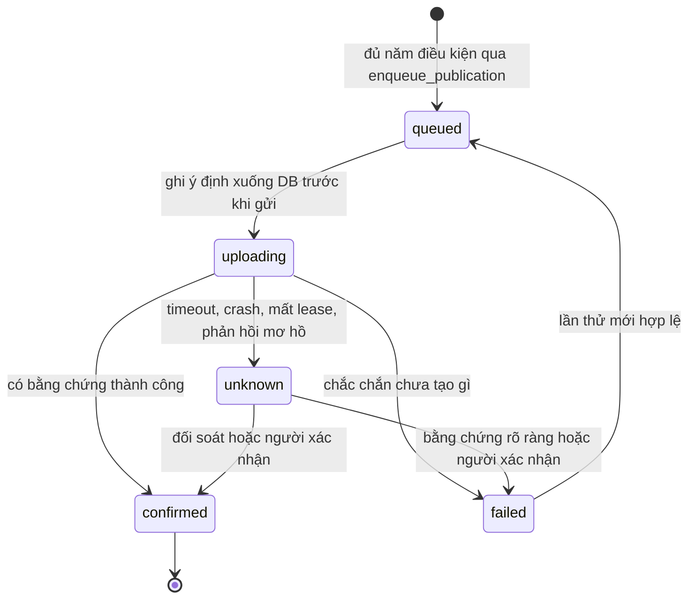

# Đặc tả độ tin cậy xuất bản

> **Trạng thái:** tài liệu đã viết; thiết kế `Proposed` (D-019); chờ Chủ dự án duyệt trước Phase 15; chưa triển khai; chưa kiểm thử.
> Khả năng cụ thể của từng API phải được xác minh theo [platform-verification.md](../deployment/platform-verification.md). Đây không phải tuyên bố rằng nền tảng nào đã cấp quyền cho dự án, hay rằng dự án tuân thủ chính sách của nền tảng.

## 1. Nguyên tắc

- **Thà chưa đăng còn hơn đăng trùng.** Mục tiêu là at-most-once. Exactly-once không đạt được qua API bên ngoài, nên phần mơ hồ được chuyển cho con người.
- **Timeout không có nghĩa là thất bại.** Nền tảng có thể đã nhận video dù phản hồi không về tới máy.
- Mỗi cặp (nền tảng, đích đăng) có một bản ghi `publications` riêng. Lỗi nền tảng này không ảnh hưởng nền tảng khác.

## 2. Máy trạng thái

| Trạng thái | Ý nghĩa | Được tự động làm gì |
|---|---|---|
| `queued` | Đủ điều kiện, chưa gửi gì | Bắt đầu upload |
| `uploading` | Đã ghi ý định, có thể đã gửi dữ liệu | Tiếp tục cùng phiên upload nếu API cho phép |
| `confirmed` | Có bằng chứng nền tảng đã tạo nội dung | Không gì thêm; **không có đường quay lại** |
| `unknown` | Không rõ kết quả | **Chỉ đối soát, chỉ đọc. Không upload** |
| `failed` | Có bằng chứng chưa tạo nội dung | Retry trong ngân sách nếu lỗi tạm thời |

`confirmed` nghĩa là nền tảng đã nhận và trả định danh, không có nghĩa video đã hiển thị công khai. Trạng thái xử lý phía nền tảng lưu ở trường riêng `platform_status`. Nếu nền tảng từ chối nội dung sau đó, việc này được báo cho người xử lý và không tự động đăng lại.

`unknown` có cờ `review_required`. Run giữ `BLOCKED` chừng nào còn bản ghi `unknown`.

## 3. Phân loại kết quả

| Tình huống | Chuyển sang |
|---|---|
| Kiểm tra lại thất bại trước khi gửi (`revalidation_failed`) | `failed`, run `BLOCKED` |
| Yêu cầu của nền tảng không cho đăng lúc này, trước khi gửi nội dung (ví dụ giới hạn số bài) | `failed`, không retry tự động, báo người dùng thử lại sau |
| Chưa có byte nào được gửi (không kết nối được, lỗi DNS, kiểm tra cục bộ thất bại) | `failed` |
| Nền tảng từ chối rõ ràng trước khi tạo nội dung (xác thực, quyền, định dạng, quota) | `failed`, không retry với lỗi không tạm thời |
| Có định danh và phản hồi thành công | `confirmed` |
| Timeout sau khi đã gửi yêu cầu hoàn tất | `unknown` |
| Mất kết nối giữa chừng và không tiếp tục được phiên upload | `unknown` |
| 5xx ở bước tạo hoặc hoàn tất | `unknown` |
| Crash, `SIGKILL`, mất lease khi `uploading` | `unknown` |
| Phản hồi không phân tích được | `unknown` |

**Khi nghi ngờ, luôn chọn `unknown`.** Sau khi khởi động lại, mọi bản ghi `uploading` chuyển `unknown`, không quay lại `queued`.

## 4. Ghi ý định và bằng chứng

1. **Trước khi gửi:** chạy lại toàn bộ kiểm tra theo [security-and-rights.md](security-and-rights.md) mục 8, rồi trong cùng transaction đặt `uploading`, ghi `attempt_id`, thời điểm, SHA-256 video, đích đăng.
2. **Ngay khi nhận được:** lưu định danh trả về (request ID, mã phiên, publish ID, external ID) **trước khi thực hiện bước tiếp theo**.
3. **Mọi phản hồi:** lưu mã trạng thái, thời điểm, trích đoạn đã che dữ liệu nhạy cảm.

**Không lưu:** access token, refresh token, header `Authorization`, URL có chứa token. URL phiên upload có thể có giá trị như một bearer credential, nên được coi là secret, lưu trong Keychain trong thời gian phiên còn hiệu lực và chỉ lưu dạng đã che ở DB.

## 5. Đối soát

Job đối soát chỉ đọc, chạy với backoff, trong một khoảng thời gian giới hạn. Mức tin cậy từ cao xuống thấp:

| Bằng chứng | Kết luận |
|---|---|
| Tra cứu theo định danh đã lưu | Có thể kết luận `confirmed` hoặc `failed` theo trạng thái trả về |
| Trạng thái phiên upload | Có thể kết luận nếu tài liệu API định nghĩa rõ |
| Liệt kê nội dung gần đây của đích đăng, khớp dấu hiệu định danh và khoảng thời gian | Chỉ `confirmed` khi khớp đúng một kết quả chắc chắn |
| Không tìm thấy gì | **Không phải bằng chứng thất bại**, vì nền tảng có thể đang xử lý. Tiếp tục đối soát, hết thời hạn thì chuyển người duyệt |

Mỗi adapter khai báo khả năng trong `PublishCapabilities`: tra cứu theo định danh, tiếp tục phiên, liệt kê nội dung, hỗ trợ khóa idempotency. Khả năng không được xác minh từ tài liệu chính thức mặc định là `false`. **Thiếu khả năng đối soát thì `unknown` đi thẳng tới người duyệt.**

## 6. Xem xét của con người

Dashboard hiển thị bằng chứng đã có và đường dẫn kiểm tra thủ công. Người duyệt chọn:

- **Đã đăng:** nhập external ID hoặc URL, chuyển `confirmed`.
- **Chưa đăng:** chuyển `failed`, cho phép lần thử mới.

Mọi quyết định được ghi vào `audit_log`, gồm người duyệt, thời điểm, bằng chứng. Hệ thống không tự giải quyết `unknown` khi hết thời hạn.

## 7. Chống đăng trùng

- **Ràng buộc DB:** chỉ một bản ghi đang hoạt động (`queued`, `uploading`, `unknown`, `confirmed`) cho mỗi `(video_sha256, platform, destination)`, thực thi bằng unique index một phần.
- Thao tác phê duyệt và tạo `queued` là idempotent: bấm hai lần chỉ tạo một bản ghi.
- Khóa idempotency của nền tảng chỉ được dùng nếu đã xác minh là có, và là lớp bổ sung, không thay thế các quy tắc trên.
- **Cố ý đăng lại** yêu cầu phê duyệt mới, lý do, và ghi audit. Đây là đường duy nhất vượt qua ràng buộc trên, không có retry tự động nào được dùng đường này.
- Job Tesla chịu fencing như mọi job, nhưng mất lease dẫn đến `unknown`, không dẫn đến retry.

## 8. Tiêu chí nghiệm thu (Phase 15–16)

| Mã | Tiêu chí |
|---|---|
| AC-P1 | Không có đường tự động nào đi từ `unknown` tới upload |
| AC-P2 | Mọi bản ghi `uploading` còn lại sau khởi động chuyển thành `unknown` |
| AC-P3 | Ý định được ghi xuống DB trước byte mạng đầu tiên |
| AC-P4 | Định danh được lưu trước bước tiếp theo |
| AC-P5 | Không thể tạo hai bản ghi hoạt động cho cùng video và đích đăng |
| AC-P6 | Bấm phê duyệt nhiều lần chỉ tạo một lượt đăng |
| AC-P7 | `unknown` không xác định được luôn dừng ở trạng thái chờ người |
| AC-P8 | Không tìm thấy kết quả không bị coi là thất bại |
| AC-P9 | Không có token trong DB, log, artifact |
| AC-P10 | Đăng lại có chủ đích bắt buộc có phê duyệt mới và audit |
| AC-P11 | Lỗi một nền tảng không ảnh hưởng nền tảng khác |

## 9. Kiểm thử với máy chủ giả lập

Kiểm thử tự động dùng adapter giả cục bộ, không gọi nền tảng thật.

| Mã | Kịch bản | Mong đợi |
|---|---|---|
| PF-01 | Máy chủ nhận hoàn tất nhưng không trả lời | `unknown`, đúng một nội dung phía máy chủ |
| PF-02 | Crash sau khi máy chủ trả lời, trước khi lưu | `unknown`, đối soát tìm ra, `confirmed`, một nội dung |
| PF-03 | Crash trước khi gửi byte nào, sau khi ghi ý định | `unknown`, không tự upload |
| PF-04 | 5xx ở bước hoàn tất, nội dung thực ra đã tạo | `unknown`, không đăng trùng |
| PF-05 | Kết nối bị từ chối, chưa gửi byte nào | `failed`, retry được |
| PF-06 | Lỗi phân quyền rõ ràng | `failed`, không retry |
| PF-07 | Đối soát không tìm thấy đến hết hạn | Chờ người, không tự kết luận |
| PF-08 | Hai bản ghi hoạt động cùng video | DB từ chối |
| PF-09 | Bấm phê duyệt đồng thời | Một lượt đăng |
| PF-10 | Mất lease khi `uploading` | `unknown`, worker cũ không ghi đè |
| PF-11 | Liệt kê nội dung khớp nhiều kết quả | Chuyển người, không đoán |
| PF-12 | Adapter thiếu khả năng đối soát | Thẳng tới người duyệt |
| PF-13 | Dùng giá trị canary trong luồng giả lập | Không xuất hiện trong log, DB, workspace |
| PF-14 | Asset bị đổi sau khi `queued` | `failed`, `revalidation_failed`, không gửi byte nào |
| PF-15 | Gọi adapter không có `PublishGrant` | Bị từ chối, không gửi byte nào |
| PF-16 | Yêu cầu nền tảng đổi giữa lúc đồng ý và lúc gửi | Quay lại xin đồng ý, không gửi nội dung |
| PF-17 | Lựa chọn quyền riêng tư không còn nằm trong danh sách cho phép | Từ chối, không gửi |
| PF-18 | Chưa có đồng ý rõ ràng | Không gửi nội dung |
| PF-19 | Nền tảng báo đã hết giới hạn đăng | `failed`, không retry tự động, có thông báo |
| PF-20 | Video dài hơn giới hạn của tài khoản | Chặn trước khi gửi |
| PF-21 | Payload YouTube thử nghiệm | Có `privacyStatus=private` tường minh |
| PF-22 | Phản hồi trả về khác quyền riêng tư đã yêu cầu | `review_required`, không tự sửa |

## 10. Ranh giới adapter

Mọi chi tiết riêng của nền tảng nằm **sau adapter của Tesla**. Phần còn lại của hệ thống chỉ biết giao diện chung:

| Thao tác | Vai trò |
|---|---|
| `prepare(destination)` | Lấy yêu cầu hiện hành, trả `PublishRequirements` |
| `validate(intent, requirements)` | Kiểm tra lựa chọn của người dùng |
| `publish(grant)` | Gửi nội dung, chỉ với `PublishGrant` hợp lệ |
| `check_status(evidence)` | Đối soát chỉ đọc |
| `capabilities()` | Khai báo `PublishCapabilities` |

Dashboard hiển thị `PublishRequirements` theo cách chung: tên đích đăng, các lựa chọn, văn bản đồng ý, cảnh báo. Không có logic theo tên nền tảng trong dashboard, API hay Factory Manager.

**Đồng ý theo nền tảng** được lưu ở `publish_intents`, tách khỏi phê duyệt nội dung, và gắn cùng `package_sha256`. Tesla không thêm trách nhiệm mới; các điều dưới đây là chi tiết của việc xuất bản.

## 11. Yêu cầu theo nền tảng

Theo tài liệu đã đọc ngày 2026-10-30. **Phải xác minh lại ngay trước khi viết adapter** theo [platform-verification.md](../deployment/platform-verification.md). Mục này không phải là tuyên bố tuân thủ.

### TikTok

> **`POLICY BLOCKED`.** Direct Post xung đột với mục đích dùng cá nhân của dự án: hướng dẫn chính thức loại trừ công cụ upload cho tài khoản của chính mình. Audit không phải thủ tục đủ để mở khóa.
>
> Phê duyệt phương án C chỉ cho phép tiếp tục đánh giá khả năng tích hợp. Quyết định này không cấp quyền triển khai TikTok Direct Post API. Các yêu cầu dưới đây **chỉ có hiệu lực sau khi** đủ năm điều kiện G1–G5 tại [platform-verification.md](../deployment/platform-verification.md) mục 3, gồm quyết định triển khai riêng của Project Owner. Việc đã chấp nhận rủi ro không thay thế điều kiện nào. Đáp ứng các yêu cầu này cũng không làm dự án đủ điều kiện.

- **Luôn truy vấn creator info** khi hiển thị màn hình đăng và ngay trước khi gửi.
- Hiển thị tên của creator để người dùng biết đang đăng vào tài khoản nào.
- **Chỉ đưa ra các tùy chọn quyền riêng tư mà creator info trả về. Không có giá trị mặc định;** người dùng phải tự chọn.
- Tùy chọn tương tác (bình luận, Duet, Stitch) không được bật sẵn, và bị vô hiệu hóa nếu creator đã tắt.
- Chặn video dài hơn giới hạn thời lượng của creator.
- Có phần khai báo nội dung thương mại theo hướng dẫn; tắt mặc định.
- Tôn trọng giới hạn đăng: nếu creator không thể đăng lúc này, dừng và báo thử lại sau. Không tự retry để vượt giới hạn.
- Client chưa audit bị giới hạn ở chế độ riêng tư. Không được quảng bá việc đăng công khai trước khi audit xong.
- **Không gửi nội dung tới TikTok trước khi có đồng ý rõ ràng** của người dùng; hiển thị bản xem trước và văn bản đồng ý theo hướng dẫn hiện hành.
- Người dùng phải sửa được văn bản đặt sẵn như tiêu đề và hashtag. Không thêm watermark quảng bá.
- Theo dõi trạng thái qua `publish_id`, và cho người dùng biết việc xử lý có thể mất thời gian.

**Bằng chứng lưu lại:** ảnh chụp creator info đã dùng (tên hiển thị, tùy chọn được phép, giới hạn thời lượng), lựa chọn quyền riêng tư và tương tác, phiên bản văn bản đồng ý, người đồng ý, thời điểm, `package_sha256`, `publish_id`, `logid` nếu có. Không lưu token.

### YouTube

- Video thử nghiệm **phải đặt tường minh `status.privacyStatus=private`** trong yêu cầu. **Không dựa vào giá trị mặc định của API.**
- Sau khi upload, đọc lại trạng thái quyền riêng tư; khác với yêu cầu thì `review_required`.
- Chuyển sang công khai là quyết định riêng của Chủ dự án.
- Kiểm tra lại quota và yêu cầu upload ngay trước khi triển khai.

### Facebook

Quyền và yêu cầu App Review **chưa được xác minh** để dùng cho triển khai. Không viết adapter cho tới khi có hồ sơ xác minh đầy đủ.

## 12. Tiêu chí nghiệm thu bổ sung

| Mã | Tiêu chí |
|---|---|
| AC-P12 | Không có logic theo tên nền tảng ngoài adapter |
| AC-P13 | TikTok, chỉ áp dụng sau khi mở cổng G1–G5: creator info được truy vấn trước mỗi lần đăng |
| AC-P14 | TikTok: không có giá trị quyền riêng tư mặc định; chỉ nhận giá trị được phép |
| AC-P15 | Không byte nội dung nào được gửi trước khi có đồng ý ghi nhận |
| AC-P16 | Bằng chứng đồng ý và xuất bản được lưu đầy đủ, không có token |
| AC-P17 | Mọi upload thử nghiệm YouTube đặt `privacyStatus=private` tường minh |
